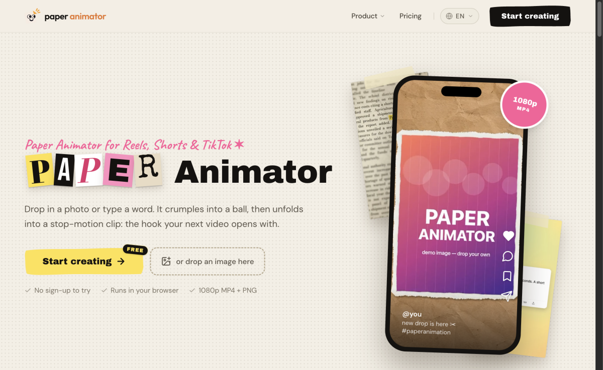
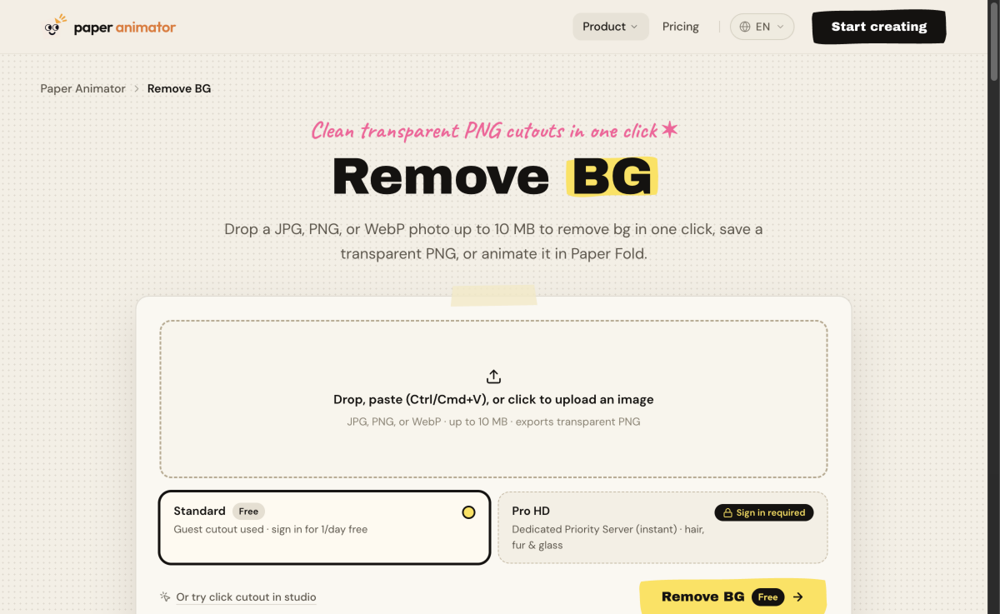
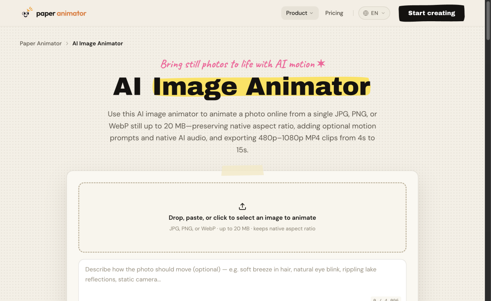
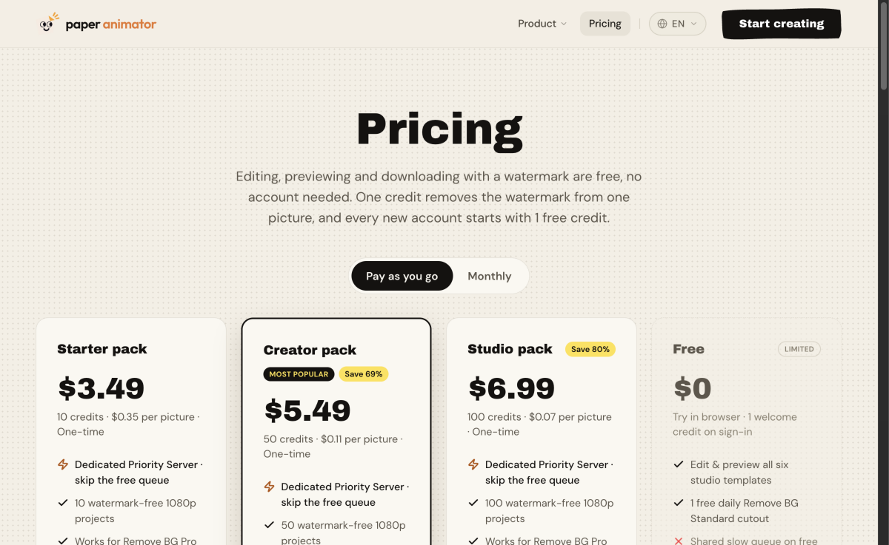
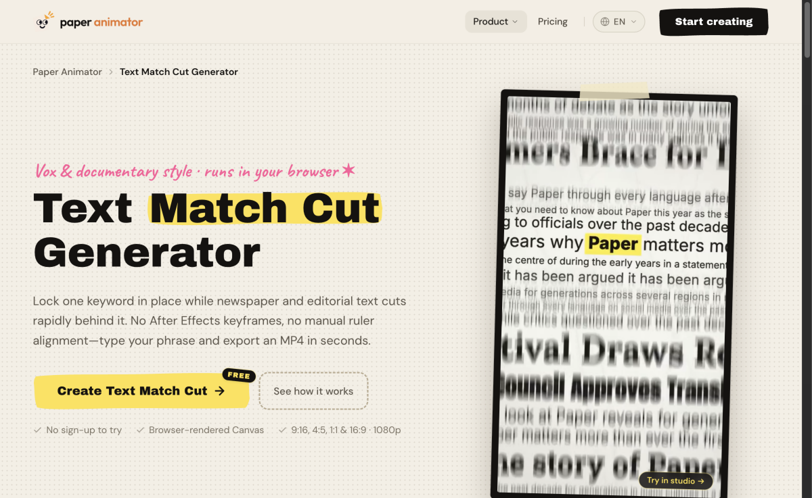

# Paper Animator

**Turn a photo or a word into a stop-motion paper animation — right in the browser.**

Paper Animator is a browser-based creative studio for short-form creators who need tactile, hand-made paper motion without building keyframes by hand. Drop in an image and a crumpled paper ball tears open and unfolds into a torn-edge sticker; or type a word and watch cut-out paper letters unfold one by one.

- Website: **https://paperanimator.org/**
- Try it free (no sign-up): https://paperanimator.org/
- Category: Design & video / image-to-video / background removal / text animation

## What it does

| Studio | Input | Output |
| --- | --- | --- |
| **Paper Fold** | JPG / PNG / WebP or typed text | Stop-motion paper fold, MP4 or transparent PNG |
| **Text Match Cut** | Text | Cut-out paper letters unfolding, stop-motion |
| **Remove BG** | Image | Transparent PNG cutout |
| **AI Image Animator** | Image | 4-second animated clip |
| **Newspaper Highlight** | Text | Headline paper-tear animation |
| **Ransom Note / Magazine Letters** | Text | Cut-out letter collage animation |

Edge style, edge thickness, shadow, picture size, background (kraft paper, parchment, solid colour, green screen) and decorative stickers are all adjustable. The fold runs at roughly eight poses per second, so output reads as stop-motion rather than smooth motion graphics.

## Features

- **Photo → paper fold** — a crumpled white paper ball tears open and unfolds into your picture as a torn-edge, white-border sticker
- **Typed text → cut-out letters** — paper letters unfold one by one
- **Six templates** — Newspaper Highlight, Tweet Cards, Magazine Letters, Press Coverage, Text Match Cut, Ransom Note
- **Background removal** — transparent PNG cutouts, one free Standard cutout per day
- **AI image animator** — still photo to a 4-second motion clip
- **Export anywhere** — MP4 with optional paper-tick sound, or transparent PNG, in 9:16 / 1:1 / 16:9 at 720p or 1080p, ready for CapCut, Premiere Pro or DaVinci Resolve
- **Runs on the device** — studio tools render locally, so images stay local, and no account is needed to try
- **Chrome extension** — right-click any text to generate paper animation

## Pricing

Free to try, with a watermark on 720p downloads and a shared slow queue.

| Plan | Price | What you get |
| --- | --- | --- |
| **Free** | $0 | Try every studio in the browser, 1 welcome credit on sign-in, 1 free daily Remove BG Standard cutout, watermark on 720p |
| **Starter** | $3.49 one-time | 10 credits (watermark removal, $0.35 / picture) |
| **Creator** | $5.49 one-time | 50 credits ($0.11 / picture, most popular) |
| **Studio** | $6.99 one-time | 100 credits ($0.07 / picture) |
| **Unlimited** | $8.99 / month | No credit counts, priority server, instant exports, no watermark, every format up to 1080p |

## More text templates

## Use cases

- Reels / Shorts / TikTok hooks — open your video with a paper peel reveal
- Explainer B-roll — hand-made paper motion instead of stock footage
- Podcast & meme clips — turn a quote into cut-out paper letters
- Product launch teasers — logo revealed out of a crumpled paper ball

## Links

- Home: https://paperanimator.org/
- Pricing: https://paperanimator.org/pricing
- Remove BG: https://paperanimator.org/remove-bg
- AI Image Animator: https://paperanimator.org/image-animator
- Text Match Cut: https://paperanimator.org/text-match-cut
- Newspaper Highlight: https://paperanimator.org/newspaper-highlight-generator
- Ransom Note: https://paperanimator.org/ransom-note-text-generator
- Tweet Video Maker: https://paperanimator.org/tweet-video-maker
- Blog: https://paperanimator.org/blog
- Support: support@paperanimator.org

## License

Content and screenshots © Paper Animator. This repository is the public product listing used for directory submissions.
